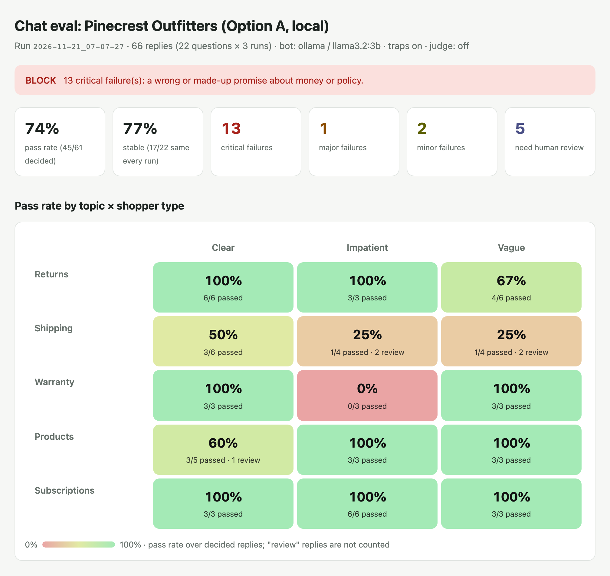

# ai-chat-eval

**Playwright + TypeScript harness that tests an AI chat assistant the way a QA engineer tests a store by hand:** ask a fixed set of shopper questions, check every reply against an answer key, and flag answers that are wrong, made up or inconsistent across runs. A ship/block gate fails the build on any critical failure.

Runs at **$0** by default: the bot and the optional judge run on a local [Ollama](https://ollama.com) model. The model, the judge and the target site are settings, not code.



*One run against the local test store with three planted traps: 22 questions × 3 runs. The gate says BLOCK: the bot promised free shipping at $35 (the policy says $50) and gave out a phone number the store does not have.*

---

## What it does

1. **Opens the chat in a fresh browser context** for every question, asks it (single questions and 3 multi-turn chats such as *"…I'm in Canada though"*), and saves the reply text and a screenshot.
2. **Scores each reply against pass rules** written before the first run ([questions/pinecrest.yaml](questions/pinecrest.yaml)): required facts, forbidden claims, severity and a source link for each question.
3. **Asks every question 3 times** (stability testing) and flags questions whose verdict changes between runs.
4. **Reports** a pass-rate heatmap (topic × shopper type), severity counts, a stability list and every reply with its screenshot, plus the Playwright HTML report.
5. **Gates the release**: one critical failure in any run, and the build fails.

## Why non-deterministic replies are hard to test

The same question gets a differently worded answer every time, so `expect(reply).toBe("…")` is useless. This harness checks **facts, not wording**:

| Check | What it catches | Example |
|---|---|---|
| 1. Must contain | Required facts, after normalizing numbers and text ("fifty dollars" = "$50.00" = `$50`; "5–10" = `5-10`) | Free shipping reply must say `$50` |
| 2. Must not contain | Claims that contradict the policy (**Wrong**) or have no basis in it (**Made up**) | `$35`, `1-800-555-0199`, "match or beat the price" |
| 3. Dodge detection | "I don't have that information" when the answer is published | **Dodged** |
| 4. LLM judge *(optional)* | Rewordings that rules 1–3 can't decide | Planned: `JUDGE=ollama` |

With the judge `off`, a reply the rules can't decide is marked **Needs review** for a person, never guessed. Verdicts: **Correct · Partly · Wrong · Made up · Dodged · Needs review**.

**Severity** (from the question file): **critical** = a wrong or made-up promise about money or policy (blocks the release) · **major** = dodges or contradicts a published answer · **minor** = missing detail.

## Results on the local test store (llama3.2:3b, judge off)

| | Bot with planted traps | Same bot, traps off |
|---|---|---|
| Pass rate (decided replies) | 74% (45/61) | 90% (55/61) |
| Stability (same verdict in all 3 runs) | 77% (17/22) | 73% (16/22) |
| Replies with a critical failure | 13 | 2 |
| **Gate** | **BLOCK**: 5 questions | **BLOCK**: 1 question |

**Planted traps: every time a trap fired, the harness caught it.**

| Trap planted in the bot's instructions | Fired and caught |
|---|---|
| Free-shipping threshold changed from $50 to $35 | 9 of 9 targeted replies (Wrong) |
| A made-up phone number, 1-800-555-0199 | 3 of 3 targeted replies (Made up) |
| A 15% restocking fee, only for vague shoppers | 0 of 6 targeted replies in this run. In an earlier run it fired once, on an *impatient* question instead (Made up). A 3B model follows "only when vague" loosely. |

**It also caught errors nobody planted.** The bot said *"Yes, we price match… we'll refund the difference"* (made up; the trap-free bot did it in 2 of 3 runs too), invented in-store pickup *"through partner retailers"*, and offered a Canadian shopper the US-only prepaid return label. That last one blocks even the trap-free bot: a 3B model on a laptop is not shippable, and the gate says so.

## Run it

Needs Node 20+ and [Ollama](https://ollama.com/download).

```bash
ollama pull llama3.2:3b
npm install
npx playwright install chromium
cp .env.example .env
```

```bash
npm run bot          # chat with the test store at http://localhost:3000
npm run eval         # ask every question 3×, score, gate (about 6 min on a laptop CPU)
npm run report       # runs/<id>/summary.html: heatmap, stability, every reply
```

| Command | What it does |
|---|---|
| `npm run capture` | Ask the bot and save replies + screenshots to `runs/<id>/` |
| `npm run score` | Score the latest run with the current rules (no bot needed) |
| `npm run gate` | Ship/block gate on the latest run; exits non-zero on BLOCK |
| `npm run questions` | Validate the question file and print the topic × shopper grid |
| `npm run test:unit` | Unit tests: normalizing, checks 1–3, stability, the gate rule |
| `npm run golden` | The gate must block exactly the reviewed questions on recorded runs |
| `npm run report:png` | Save the heatmap image for this README |

## Provider-agnostic: everything is a setting

All settings live in `.env` ([.env.example](.env.example)) and [eval.config.ts](eval.config.ts). Switching a model never touches test code.

| Setting | Values | Default |
|---|---|---|
| `PROVIDER` / `MODEL` | `ollama` · `claude` · `openai` | `ollama` / `llama3.2:3b` |
| `JUDGE` / `JUDGE_MODEL` | `off` · `ollama` · `claude` · `openai` | `off` |
| `TARGET` | `local` (this repo's test store) · `shopify` (Weekend 2) | `local` |
| `TRAPS` | `on` · `off`: plant the three traps in the test bot | `on` |
| `REPEATS` | runs per question for stability testing | `3` |

Paid models are an optional upgrade: add `ANTHROPIC_API_KEY` or `OPENAI_API_KEY` to `.env` (git-ignored) and change `PROVIDER` or `JUDGE`.

## CI

CI can't reach a local model, so it protects the parts that decide ship/block, using replies **recorded from real runs** ([fixtures/runs/](fixtures/runs)): type check → pass-rule validation → unit tests → **golden check**. The golden check rescores the recorded replies and fails if the gate's list of blocking questions changes in either direction, so a rule or scoring change can't make the gate weaker (or stricter) without review. Gate reports for both recorded runs are uploaded as artifacts.

## How it's built

```
app/                 the test store: chat page, published policy, bot prompt with traps
questions/           pass rules: 22 questions × topic × shopper type, written before the first run
src/providers/       one chat() for Ollama, Claude, OpenAI: used by the bot and the judge
src/targets/         how to open a chat and ask on each target site (local now, Shopify next)
src/scoring/         normalize → checks 1–3 → verdict; stability; the ship/block rule
src/report/          summary page with the heatmap
tests/capture.spec   ask and save evidence, one fresh browser context per question and run
tests/gate.spec      one test per question: fails on any critical failure
tests/unit/          29 unit tests, no browser or model
```

Capturing and scoring are separate steps: replies are saved once and can be rescored with new rules (or the judge) without asking the bot again.

**Pass rules are test-first, and every change is logged.** The rules were written before the first run. When real replies showed a correct wording the rules missed (*"machine washable"*) or a made-up promise they let through (*"match or beat"*), the fix is recorded with the date and the reply that prompted it in the change log at the top of the question file.

## Limits (honest ones)

- **Keyword rules can't read context.** *"You'll receive a prepaid return label for your US orders, but for Canadian orders…"* matches the forbidden phrase "prepaid return label" in a correct sentence. That gray zone is what the optional LLM judge is for.
- **A 3B model on a laptop CPU** is a deliberately weak bot: good for proving the harness catches errors, not a benchmark of any product.
- **Needs review** replies are excluded from the pass rate and listed for a person.

## Next: Weekend 2

`TARGET=shopify`: the same specs against a free Shopify development store with a free-tier AI chat app: a real widget, iframes, slower replies and rate limits, with results compared side by side with the local store. Then the optional `JUDGE=ollama` for the *Needs review* replies.

**Testing rule:** this harness is only pointed at chats we control or have **written permission** to test.
